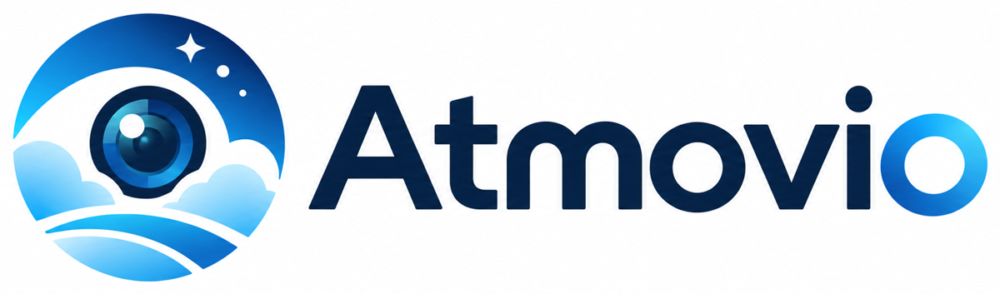
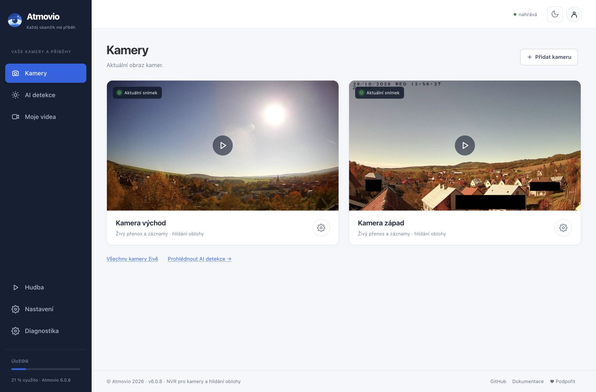
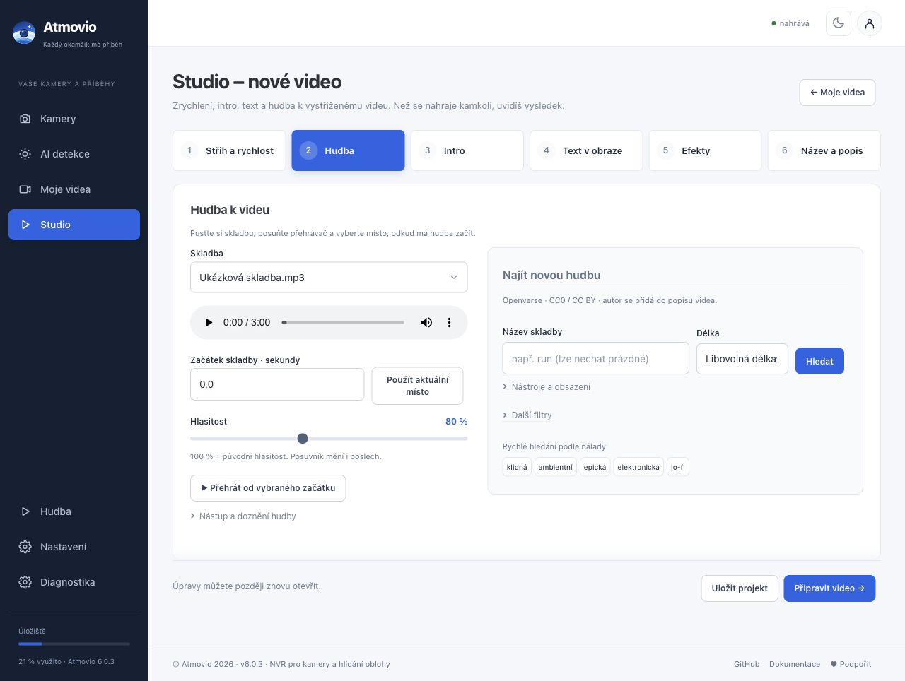

<p align="center"></p>

<p align="center"><b>Your cameras. The moments worth keeping.</b><br>Live view, recordings and timelapse creation on Raspberry Pi 5.</p>

<p align="center"><a href="README.cs.md">Česky</a> · <a href="docs/install.md">Installation</a> · <a href="https://github.com/VladimirVecera/atmovio/releases/latest">Download</a> · <a href="https://www.atmovio.com/">Website</a></p>



- **Watch and rewind.** Open a camera, explore the recording timeline and save an OD–DO selection.
- **Keep interesting moments.** Optional AI sky watching finds events; overlapping automatic clips from the same camera are combined when the source recording is available.
- **Make a video.** Trim, change speed, choose music and intro, add text or a subscribe/share callout. Save a project and edit it again later.
- **Share when ready.** Preview the finished video, download MP4 or upload to your YouTube channel.

<details><summary>See the video editor</summary>



</details>

## Get started

Raspberry Pi 5 · 64-bit Raspberry Pi OS · USB storage · an RTSP camera. See [hardware](docs/hardware.md) and [camera compatibility](docs/cameras.md).

```sh
curl -fsSL -o install.sh https://github.com/VladimirVecera/atmovio/releases/latest/download/install.sh
sudo bash install.sh
```

Open the address shown by the installer. The interface is currently in Czech. Recording works without an AI account; cloud AI features require your own provider key and may incur charges.

**Atmovio 6.0.4** includes Frigate 0.18.2, configuration validation and rollback backups. Update an existing installation in **Settings → System → Updates → Check now** (the interface is in Czech). Screenshots use demonstration data. See the [upgrade notes](docs/v6.md).

## Learn more

[Installation](docs/install.md) · [AI sky watching](docs/ai.md) · [YouTube](docs/youtube.md) · [API & Home Assistant](docs/api.md) · [Troubleshooting](docs/faq.md)

[Changelog](CHANGELOG.md) · [Contributing](CONTRIBUTING.md) · [MIT license](LICENSE) · [Support development](https://www.atmovio.com/donate/)
