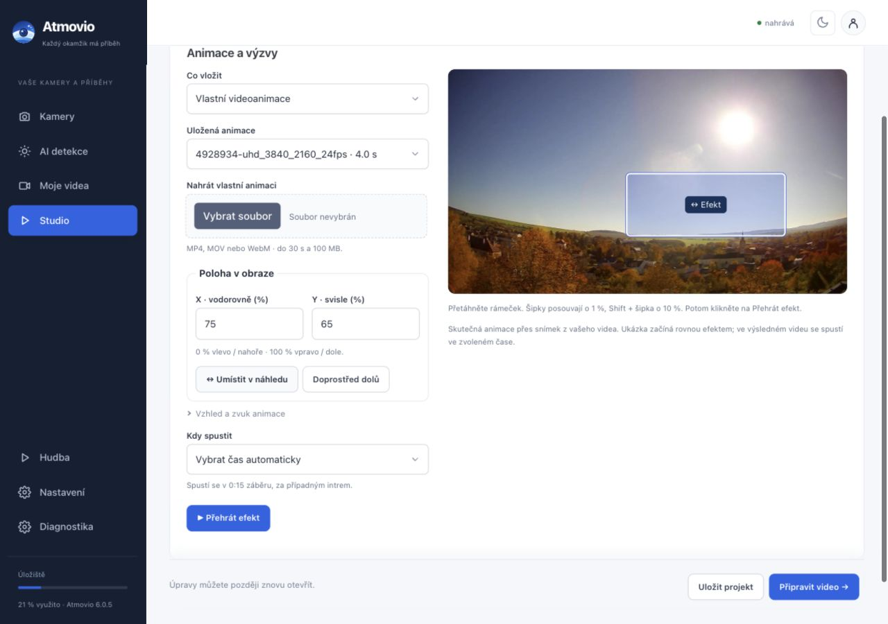

# Atmovio 6.0.6

Hlavní nabídka má čtyři místa: **Kamery, AI detekce, Moje videa a Studio**. Hudba, nastavení a diagnostika jsou ve spodní části nabídky. Technické podklady AI zůstávají v rozbalitelných detailech.

## Kamera a záznam

Kliknutím na náhled otevřete živý přenos. Pod přehrávačem vyberte den a modrý úsek časové osy. Označte **OD**, přejděte na konec a označte **DO**. Výběr lze přehrát a uložit. Klávesy I a O označují hranice; datum a čas používají časové pásmo zařízení.

Jeden výběr může mít nejvýše šest hodin. Mezery na ose znamenají chybějící záznam. U výběru s mezerou lze zkrátit rozsah nebo výslovně potvrdit uložení dostupných částí. Časová osa při přehrávání zohledňuje přeskočené výpadky. Dostupná minulost závisí na uchovávání záznamů a volném místě.

## AI detekce a Studio

AI detekce ukazují hotové klipy od nejnovějšího záznamu, bez ohledu na datum vytvoření či spojení souboru. Další nálezy AI obsahují vybraná hodnocení AI. Surová historie a fotografie slouží hlavně při hledání problémů.

Překrývající se automatické klipy stejné kamery se spojují do jednoho rozsahu, nejvýše šest hodin. Například 10:00–12:20, 10:50–13:00 a 12:00–13:30 vytvoří 10:00–13:30. Staré klipy se skryjí až po dokončení spojeného videa. Pokud původní záznam už chybí, zůstanou původní klipy dostupné. Zdroje uložených projektů se automatickým úklidem neodstraňují; prostor lze uvolnit ručně.

Přepínače ve Studiu otevírají samostatné pracovní plochy. Zdrojové video vidíte u střihu; hudba má vlastní široký přehrávač a intro vlastní náhled. Studio nabízí střih, rychlost 1× nebo časosběr 10–240×, hudbu s přehrávačem a volbou začátku, vlastní intro, text a výzvu k odběru či sdílení. Náhled zdroje slouží k výběru střihu; celý výsledek s efekty a hudbou je dostupný po přípravě videa. V Efektech můžete nahrát vlastní MP4/MOV/WebM animaci (do 30 s a 100 MB) a opakovaně ji vybírat z nabídky. **Přehrát efekt** ukáže skutečnou animaci přes snímek ze zdroje. Zelené nebo černé pozadí se odstraní automaticky; vzhled, velikost i zvuk lze změnit. V **Poloha v obraze** nastavíte **X** (vodorovně) a **Y** (svisle) v procentech. Tlačítko **Umístit v náhledu** dovoluje přetáhnout rámeček; šipky jej posunou o 1 %, se Shiftem o 10 %. Souřadnice se uloží do projektu a platí pro náhled i výsledné video. Automatický čas se počítá z délky zrychleného záběru za intrem a vejde do něj celou animaci, pokud je záběr dost dlouhý. Čas můžete zadat i ručně. Hlasitost hudby je v procentech (100 % je původní hlasitost) a mění i poslech; tlačítko pod ní přehrává od vybraného začátku. Nástup a doznění hudby se použijí až při přípravě videa. Uložený projekt lze znovu otevřít. Úprava hotového videa vytvoří další verzi; již publikované video se samo nezmění.

**Zapamatovat nastavení** předvyplní další nová videa: rychlost, hudbu, intro i efekt včetně X/Y. Tlačítko **Zrušit výchozí** zapamatování zruší. Střih, název a popis jsou vždy vlastní pro každé video; uložené projekty si ponechají svá nastavení. Náhled střihu zachovává poměr stran zdroje a ovládání má více místa.

V **Efekty → Spravovat animace** lze smazat jednotlivou animaci i všechny najednou. Z **Koše** je můžete obnovit nebo trvale odstranit nepoužívané. Animace uložených projektů zůstávají dostupné, právě zpracovávané se nemažou.

Hudební knihovna nabízí **Smazat skladbu** i **Smazat vše**. Skladby se přesunou do koše, odkud je lze obnovit. **Vysypat nepoužívané skladby** odstraní jen ty, které nepotřebuje žádný uložený projekt. Hudba v právě připravovaných videích zůstane v knihovně až do dokončení.

## Aktualizace a diagnostika

Ve starší instalaci otevřete **Nastavení → Systém → Aktualizace**, klikněte na **Zkontrolovat teď** a potom **Nainstalovat verzi 6.0.6**. Aktualizátor stáhne instalační soubor z GitHub Releases a ověří kontrolní součet. Stejnou cestou budou dostupné další vydané opravy.

Aktualizátor stáhne Frigate 0.18.2 a ověří kopii konfigurace za běhu staré verze. Před přepnutím zálohuje konfiguraci i zastavenou databázi. Během restartu vznikne krátká mezera v nahrávání. Nová verze musí potvrdit API a obraz dříve dostupných kamer; při selhání se obnoví původní Frigate i jeho databáze. Záznamy na datovém disku se nepřesouvají.

Zálohy jsou v `/opt/nvr/atmovio/backups/`. Pro diagnostiku slouží seskupené chyby, označení vyřešených problémů a export JSON. Nový výskyt vyřešené chyby ji znovu zobrazí. Export maskuje přístupové údaje a e-maily; před zveřejněním zkontrolujte také volný text.
